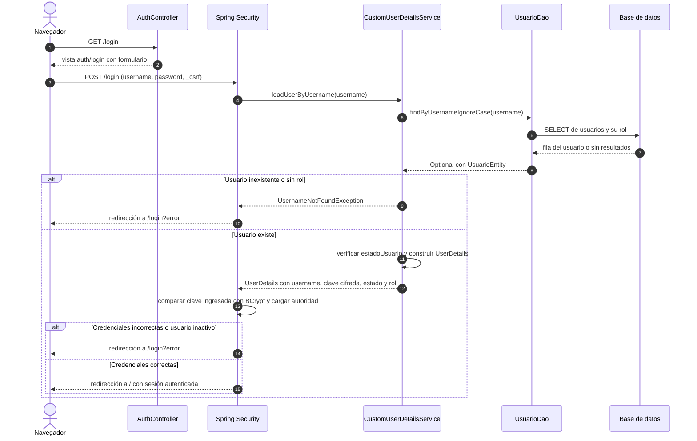
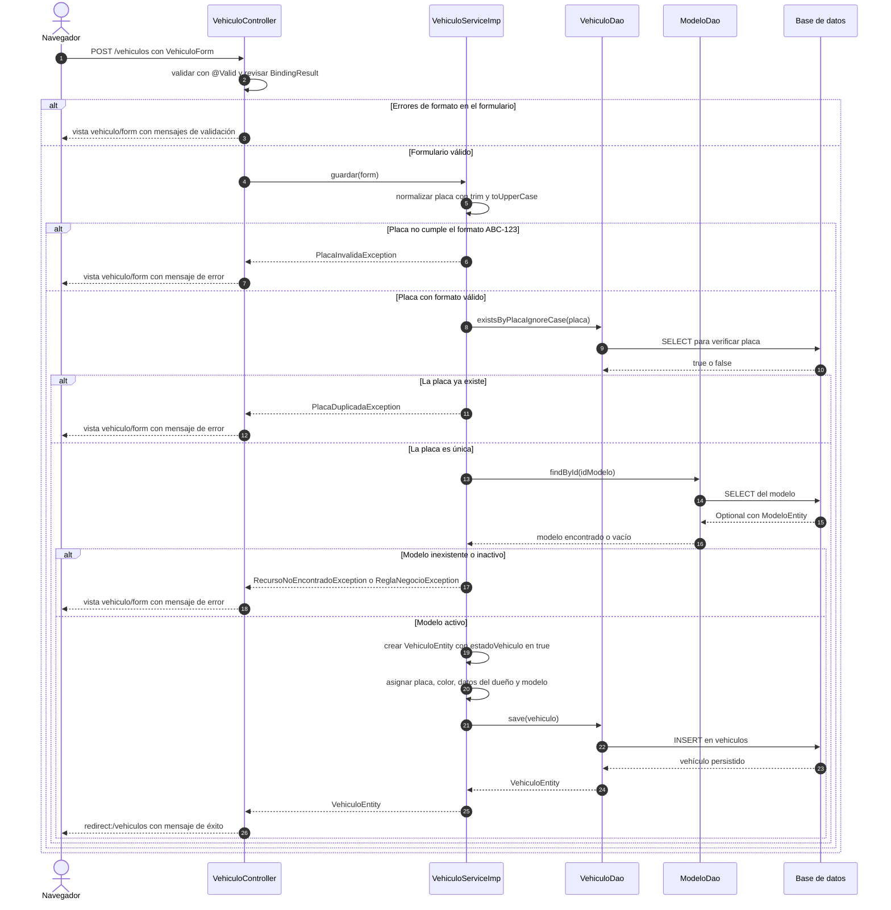
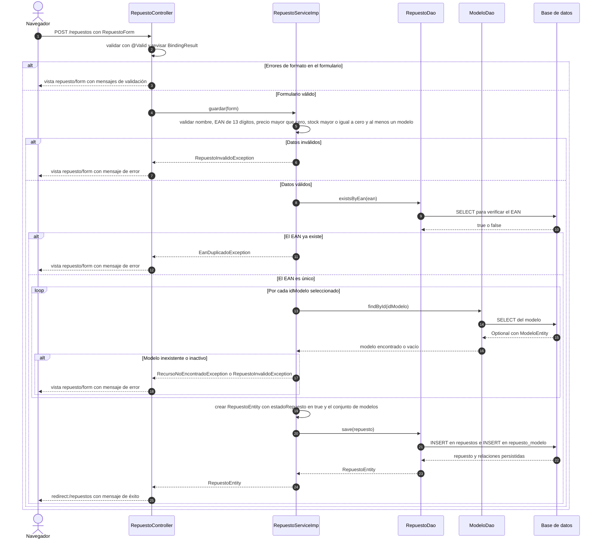
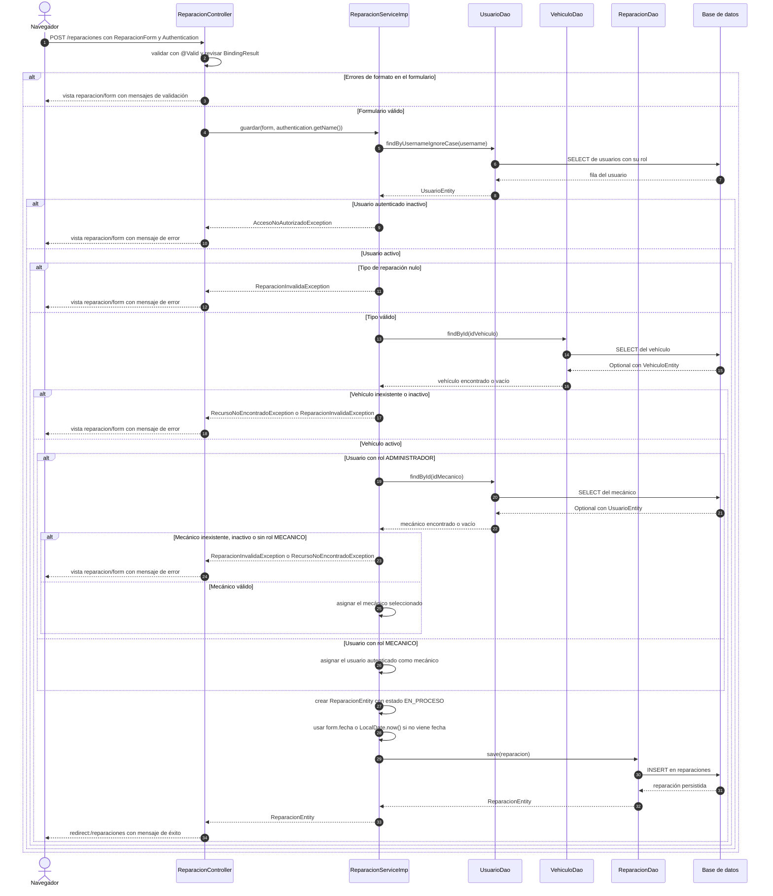
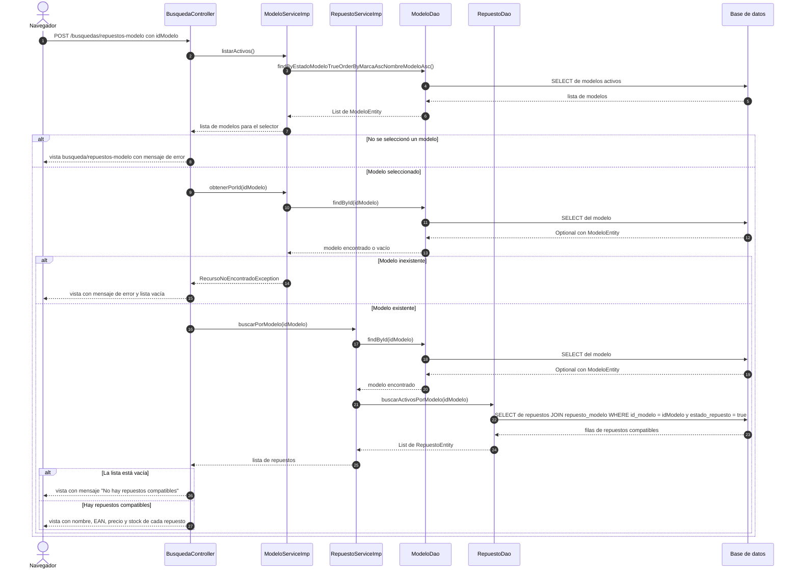
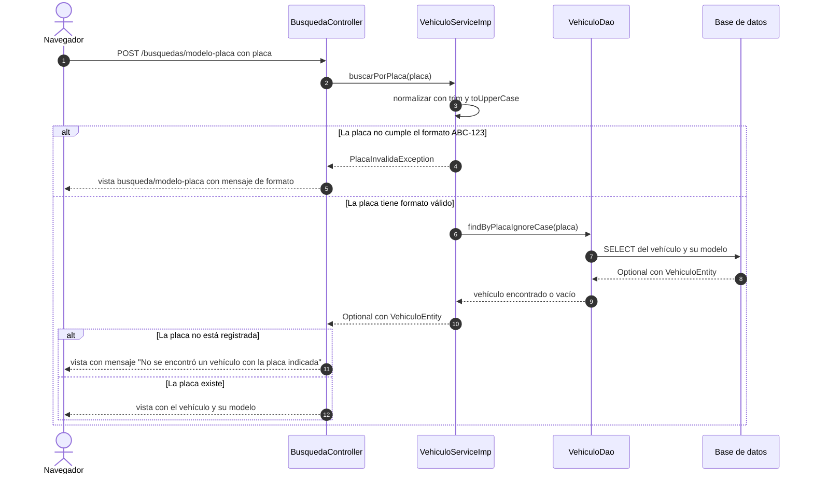
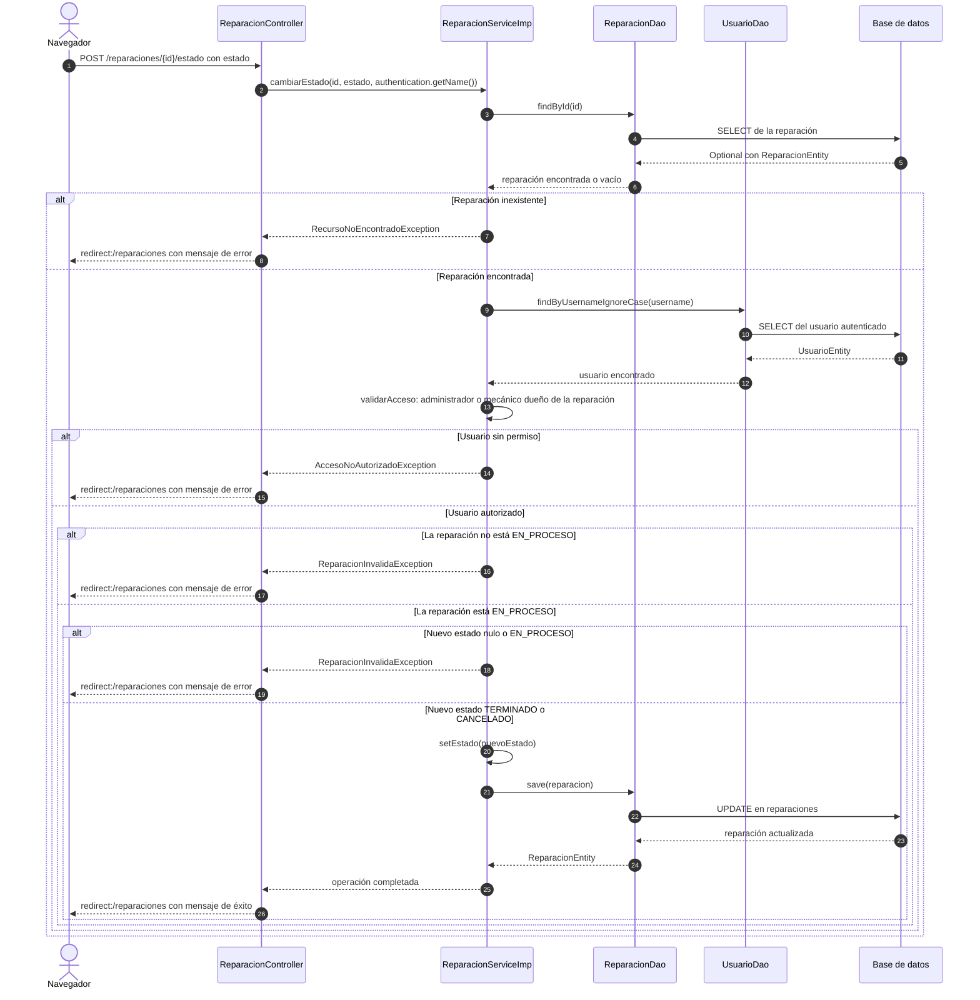

# Diagramas de secuencia — Taller Automotriz

Documento de la **parte 1** de la documentación. Los diagramas se elaboraron después de revisar el código real del proyecto: controladores, servicios, DAO, entidades y rutas. No se incluyen clases, métodos ni tablas que no existan.

## 1. Criterios usados

- **Participantes:** Navegador, controlador, servicio, DAO (repositorio) y base de datos. En el inicio de sesión se incluye el filtro de Spring Security porque el `POST /login` no lo atiende un controlador propio.
- **Nombres:** se usan los nombres reales de las clases (`VehiculoController`, `VehiculoServiceImp`, `VehiculoDao`, etc.) y de los métodos (`guardar`, `buscarPorModelo`, `cambiarEstado`, etc.).
- **Respuesta del controlador:** siempre es una vista Thymeleaf o una redirección, porque el proyecto es MVC con Thymeleaf y no tiene endpoints REST.
- **RF:** cada diagrama indica el requisito funcional que implementa. La lista completa de RF se desarrolla en la parte 3.
- **Diagrama 7:** los lineamientos reservan el séptimo diagrama para la funcionalidad de negocio que asigne la profesora. Como todavía no está asignada, en este documento se incluyen **siete diagramas de procesos obligatorios** y el séptimo es el cambio de estado de una reparación, que es una regla de negocio central del sistema. El diagrama de la funcionalidad asignada se agregará en la sección de funcionalidades adicionales, sin inventar su flujo.

## 2. Resumen de los diagramas

| N.° | Diagrama | RF relacionado | Ruta principal |
| --- | --- | --- | --- |
| 1 | Inicio de sesión | RF-01, RF-02 | `GET /login`, `POST /login` |
| 2 | Registrar un vehículo | RF-07 | `POST /vehiculos` |
| 3 | Registrar un repuesto | RF-11 | `POST /repuestos` |
| 4 | Registrar una reparación | RF-15 | `POST /reparaciones` |
| 5 | Buscar repuestos compatibles con un modelo | RF-19 | `POST /busquedas/repuestos-modelo` |
| 6 | Buscar modelo por placa | RF-20 | `POST /busquedas/modelo-placa` |
| 7 | Cambiar estado de una reparación | RF-18 | `POST /reparaciones/{id}/estado` |

### Versiones PNG para el informe

Las imágenes se generaron con Mermaid CLI a partir de los mismos bloques de este documento:

| Diagrama | Archivo |
| --- | --- |
| 1. Inicio de sesión | `diagramas/01_inicio_sesion.png` |
| 2. Registrar vehículo | `diagramas/02_registrar_vehiculo.png` |
| 3. Registrar repuesto | `diagramas/03_registrar_repuesto.png` |
| 4. Registrar reparación | `diagramas/04_registrar_reparacion.png` |
| 5. Buscar repuestos por modelo | `diagramas/05_buscar_repuestos_modelo.png` |
| 6. Buscar modelo por placa | `diagramas/06_buscar_modelo_placa.png` |
| 7. Cambiar estado de reparación | `diagramas/07_cambiar_estado_reparacion.png` |

## 3. Diagramas

### Diagrama 1 — Inicio de sesión (RF-01 y RF-02)

**Objetivo:** mostrar cómo el sistema recibe las credenciales, consulta el usuario, verifica la clave cifrada con BCrypt, carga el rol y redirige según el resultado.

**Participantes reales:** `AuthController` (solo atiende el `GET /login`), `SecurityFilterChain` (Spring Security atiende el `POST /login`), `CustomUserDetailsService`, `UsuarioDao` y la tabla `usuarios`.

**Flujo normal:** el usuario abre `/login`, envía usuario y clave; Spring Security consulta la tabla `usuarios`, valida la clave con BCrypt y crea la sesión con el rol `ADMINISTRADOR` o `MECANICO`.

**Flujos alternos:**
- Usuario inexistente: `CustomUserDetailsService` lanza `UsernameNotFoundException` y se redirige a `/login?error`.
- Clave incorrecta: Spring Security rechaza la autenticación y redirige a `/login?error`.
- Usuario inactivo: `User.disabled(true)` impide el acceso aunque la clave sea correcta.

**Trazabilidad:** `AuthController.login()`, `SecurityConfig.securityFilterChain()`, `CustomUserDetailsService.loadUserByUsername()`, `UsuarioDao.findByUsernameIgnoreCase()`.

---

### Diagrama 2 — Registrar un vehículo (RF-07)

**Objetivo:** mostrar la validación del formulario, el formato y la unicidad de la placa, la verificación del modelo y el guardado del vehículo.

**Participantes reales:** `VehiculoController`, `VehiculoServiceImp`, `VehiculoDao`, `ModeloDao` y las tablas `vehiculos` y `modelos`.

**Flujo normal:** el administrador registra un vehículo con placa `ABC-123`, color, datos del dueño y modelo; el sistema valida y guarda el registro.

**Flujos alternos:**
- Placa con formato inválido: se lanza `PlacaInvalidaException` y se vuelve al formulario.
- Placa repetida: se lanza `PlacaDuplicadaException` y se vuelve al formulario.
- Modelo inexistente o inactivo: no se guarda el vehículo.

**Trazabilidad:** `VehiculoController.crear()`, `VehiculoServiceImp.guardar()`, `VehiculoDao.existsByPlacaIgnoreCase()`, `ModeloDao.findById()`, `VehiculoDao.save()`.

---

### Diagrama 3 — Registrar un repuesto (RF-11)

**Objetivo:** mostrar la validación del EAN, precio y stock, la verificación de duplicados, la selección de modelos compatibles y el guardado en la relación muchos a muchos.

**Participantes reales:** `RepuestoController`, `RepuestoServiceImp`, `RepuestoDao`, `ModeloDao` y las tablas `repuestos`, `modelos` y `repuesto_modelo`.

**Flujo normal:** el administrador registra un repuesto, selecciona uno o varios modelos compatibles y el sistema guarda el repuesto y las filas de `repuesto_modelo`.

**Flujos alternos:**
- EAN con longitud distinta de 13 o con caracteres no numéricos: `RepuestoInvalidoException`.
- Precio menor o igual a cero, stock negativo o sin modelos: `RepuestoInvalidoException`.
- EAN repetido: `EanDuplicadoException`.
- Modelo inexistente o inactivo: no se guarda el repuesto.

**Trazabilidad:** `RepuestoController.crear()`, `RepuestoServiceImp.guardar()`, `RepuestoDao.existsByEan()`, `ModeloDao.findById()`, `RepuestoDao.save()`, tabla intermedia `repuesto_modelo`.

---

### Diagrama 4 — Registrar una reparación (RF-15)

**Objetivo:** mostrar la verificación del usuario autenticado, del vehículo y del mecánico, y la creación de la reparación con estado inicial `EN_PROCESO`.

**Participantes reales:** `ReparacionController`, `ReparacionServiceImp`, `UsuarioDao`, `VehiculoDao`, `ReparacionDao` y las tablas `reparaciones`, `vehiculos`, `usuarios` y `roles`.

**Flujo normal:** un administrador selecciona vehículo y mecánico; un mecánico registra la reparación para sí mismo. En ambos casos el estado inicial es `EN_PROCESO`.

**Flujos alternos:**
- Usuario autenticado inactivo: `AccesoNoAutorizadoException`.
- Vehículo inexistente o inactivo: no se registra la reparación.
- Administrador sin mecánico o con un usuario que no tiene rol `MECANICO`: no se registra la reparación.
- Mecánico inactivo: no se registra la reparación.

**Trazabilidad:** `ReparacionController.crear()`, `ReparacionServiceImp.guardar()`, `UsuarioDao.findByUsernameIgnoreCase()`, `VehiculoDao.findById()`, `UsuarioDao.findById()`, `ReparacionDao.save()`.

---

### Diagrama 5 — Buscar repuestos compatibles con un modelo (RF-19)

**Objetivo:** mostrar la consulta de repuestos activos a través de la relación muchos a muchos `repuesto_modelo`, incluyendo el caso sin resultados.

**Participantes reales:** `BusquedaController`, `ModeloServiceImp`, `RepuestoServiceImp`, `ModeloDao`, `RepuestoDao` y las tablas `modelos`, `repuestos` y `repuesto_modelo`.

**Flujo normal:** el usuario elige un modelo y el sistema muestra los repuestos activos asociados en `repuesto_modelo`.

**Flujos alternos:**
- Sin modelo seleccionado: mensaje de error y lista vacía.
- Modelo inexistente: mensaje de error.
- Modelo sin repuestos compatibles: mensaje "No hay repuestos compatibles".

**Trazabilidad:** `BusquedaController.repuestosPorModelo()`, `ModeloServiceImp.obtenerPorId()`, `RepuestoServiceImp.buscarPorModelo()`, `RepuestoDao.buscarActivosPorModelo()`, tabla `repuesto_modelo`.

---

### Diagrama 6 — Buscar modelo por placa (RF-20)

**Objetivo:** mostrar la normalización y validación de la placa antes de consultar el vehículo, y el caso de placa no registrada.

**Participantes reales:** `BusquedaController`, `VehiculoServiceImp`, `VehiculoDao` y las tablas `vehiculos` y `modelos`.

**Flujo normal:** el usuario escribe `ABC-123`, el sistema valida el formato, consulta el vehículo y muestra su modelo.

**Flujos alternos:**
- Placa con formato inválido: `PlacaInvalidaException` y mensaje en la vista.
- Placa válida pero no registrada: mensaje de "no encontrado".

**Trazabilidad:** `BusquedaController.modeloPorPlaca()`, `VehiculoServiceImp.buscarPorPlaca()`, `VehiculoDao.findByPlacaIgnoreCase()`.

---

### Diagrama 7 — Cambiar estado de una reparación (RF-18)

**Objetivo:** mostrar la validación de permisos, la regla de que solo se cambia el estado de una reparación `EN_PROCESO` y la prohibición de volver a un estado anterior.

**Participantes reales:** `ReparacionController`, `ReparacionServiceImp`, `ReparacionDao`, `UsuarioDao` y las tablas `reparaciones` y `usuarios`.

**Flujo normal:** el mecánico dueño o un administrador cambia una reparación de `EN_PROCESO` a `TERMINADO` o `CANCELADO`.

**Flujos alternos:**
- Reparación inexistente: mensaje de error.
- Usuario sin permiso: mensaje de error; no se modifica la reparación.
- Reparación ya `TERMINADO` o `CANCELADO`: no se permite otro cambio.
- Nuevo estado nulo o `EN_PROCESO`: no se permite; solo se aceptan `TERMINADO` o `CANCELADO`.

**Trazabilidad:** `ReparacionController.cambiarEstado()`, `ReparacionServiceImp.cambiarEstado()`, `ReparacionServiceImp.validarAcceso()`, `ReparacionDao.findById()`, `ReparacionDao.save()`.

## 4. Trazabilidad general con el código

| Proceso | Controlador | Servicio | DAO | Tablas |
| --- | --- | --- | --- | --- |
| Inicio de sesión | `AuthController` + `SecurityFilterChain` | `CustomUserDetailsService` | `UsuarioDao` | `usuarios`, `roles` |
| Registrar vehículo | `VehiculoController.crear()` | `VehiculoServiceImp.guardar()` | `VehiculoDao`, `ModeloDao` | `vehiculos`, `modelos` |
| Registrar repuesto | `RepuestoController.crear()` | `RepuestoServiceImp.guardar()` | `RepuestoDao`, `ModeloDao` | `repuestos`, `modelos`, `repuesto_modelo` |
| Registrar reparación | `ReparacionController.crear()` | `ReparacionServiceImp.guardar()` | `UsuarioDao`, `VehiculoDao`, `ReparacionDao` | `reparaciones`, `vehiculos`, `usuarios` |
| Buscar repuestos por modelo | `BusquedaController.repuestosPorModelo()` | `ModeloServiceImp`, `RepuestoServiceImp` | `ModeloDao`, `RepuestoDao` | `modelos`, `repuestos`, `repuesto_modelo` |
| Buscar modelo por placa | `BusquedaController.modeloPorPlaca()` | `VehiculoServiceImp.buscarPorPlaca()` | `VehiculoDao` | `vehiculos`, `modelos` |
| Cambiar estado de reparación | `ReparacionController.cambiarEstado()` | `ReparacionServiceImp.cambiarEstado()` | `ReparacionDao`, `UsuarioDao` | `reparaciones`, `usuarios` |

## 5. Sección preparada para la funcionalidad adicional

La funcionalidad de negocio que asigne la profesora tendrá su propio diagrama de secuencia en esta sección. Cuando se conozca, se agregarán:

- el RF correspondiente;
- la ruta y el controlador que se creen o reutilicen;
- los servicios, DAO y tablas implicados;
- el flujo normal y los flujos alternos;
- la relación con los procesos ya documentados.

No se incluye todavía un flujo inventado. La funcionalidad de estilo se documentará en la sección de interfaz, sin alterar estos siete diagramas.
